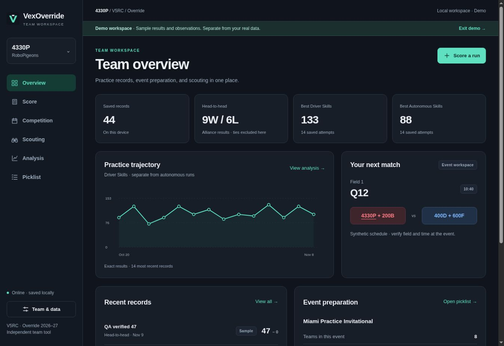

# VexOverride v2: review and rollout guide

## What is ready to review

The new app is under `/v2/`. The existing root app, `/judge/`, domain configuration, event snapshots and collection scripts are preserved. This is a replacement of the user interface and workspace model, not a new hosting platform or cloud service.

The implementation separates scoring, storage/migration, event adapters and sample generation. The interface uses graphite surfaces and teal actions; red, blue and yellow identify game data. Phone navigation and controls use the same visual system as desktop.

[Mobile scouting review screenshot](images/v2-mobile.png)

## Step by step

1. **Open the populated demo.** Run `npm run dev`, then open the server's `/v2/?dev=1` route. It creates 42 sample records, a sample event, observations and picks automatically. The demo has its own storage key. `scripts/mobile-preview.html` provides an optional width simulator.
2. **Review the scorer.** Enter one red half and three yellow halves in the top quadrant, set the toggle red, and award red the autonomous bonus. Red should have 47 points. Save, reload, and inspect its breakdown. Try Driver Skills: red halves in the top quadrant must not score.
3. **Review scouting and picks.** Open Scouting, record one robot's autonomous task result, select two teams to compare, add candidates and reorder the picklist. Selected/declined statuses persist. The order is yours; it is not an unvalidated robot rating.
4. **Open the real workspace.** Exit demo. Choose your team number; its name is matched against the public snapshot, with manual entry available. The real workspace starts with no synthetic records. Import existing v1 history from Team & data if wanted; the original data is copied, not changed.
5. **Refresh event data.** Use the repository's existing collection/import process, then run `npm run build:teams` and `npm run check`. The new lookup file is derived from the same snapshots. This is still a manual refresh; no recurring collector was added.
6. **Test on a physical phone.** Score an entire practice run with touch input. Check numeric keyboard behavior, all five field zones, saved records, and portrait/landscape. Open the app online, load an event, check “Offline shell installed” in Team & data, then test reload and saving in airplane mode. Reconnect and export a backup.
7. **Confirm the deployment source.** Check the repository's Settings → Pages and the active domain/hosting project. A custom domain alone does not establish which branch/folder is deployed. The authoring environment could not verify this setting. No hosting account password is needed in chat.
8. **Release the review route.** Once the deployment source is confirmed, merge the branch through its pull request. On a host that serves the repository root, `/v2/` becomes available alongside the original app. Verify that route and its modules on the actual domain before changing the main entry point.
9. **Cut over only after a real practice session.** Export a real backup first. Retain the old app temporarily. Plan migration of local data and the service-worker scope before moving v2 from `/v2/` to `/`; do not just move files and assume all paths still work.

## Verified in the development environment

- Existing syntax checks, judge-page consistency check, and analysis-coach fixtures pass.
- New tests cover hand-worked head-to-head/Skills scoring, tied midfield, independent colored halves, toggle margin arithmetic, invalid field data, official-score overrides, summary statistics, stale-tab write rejection, separate storage keys, malformed restores, legacy conversion, missing/partial Skills results, and observation denominators.
- All 439 existing event snapshots pass the import contract. The actual Ransom event loads with 28 teams and unknown Skills results rather than invented zeros.
- Browser: a 47-point scoring example saves and survives reload. Direct number entry and +/- controls both update the field.
- Browser: scouting observations save; HTML-like note text stays text; comparison shows separate denominators; reordered picks and declined status survive reload.
- Browser: fresh real storage contains zero records while demo records remain present. Team 4330P matches the snapshot name and location.
- Browser: backup download completes and its JSON passes the restore validator.
- Browser: service-worker registration reports an installed offline shell.
- Responsive simulation: all six screens have no page-level horizontal overflow at 320, 390 and 768 pixel iframe widths. Scouting becomes a stacked list on narrow phones; some analysis tables can scroll within their own containers.

## Remaining limits — do not call these complete

- This is a local browser workspace. There are no shared accounts, permissions, multi-device synchronization or cloud backups. A stale tab is prevented from overwriting newer saved data, but that is not a collaborative database.
- The current public snapshot is old. A downloaded event is a dated snapshot, not live standings. Team registration and event Skills availability are only as current as that snapshot.
- Competition mode supports event selection, locally entered schedules, observations and picks. The existing collector does not supply a complete automatic match schedule/results/rankings feed.
- The scorer assumes the user has identified legally placed, visible pin halves and qualifying midfield robots. It does not adjudicate placement, penalties, autonomous AWP conditions, or field legality. Official head-to-head totals can be entered separately from the preserved field calculation.
- Analysis describes saved records. It does not estimate individual robot contribution from an alliance total, infer causation, or provide calibrated win probabilities. Skills totals with one missing component are marked partial.
- Saved records can be inspected and deleted; a dedicated correction/edit-history workflow is not implemented yet. Scouting notes are local, and importing a backup replaces the selected v2 workspace after confirmation.
- Phone-width simulation is not physical-device certification. Airplane-mode reload, private browsing/storage restrictions, installation behavior, and printed output still need real-device checks.
- V2 currently uses English. The existing app retains its earlier language support.
- The root-domain cutover has not been performed. This branch is a review candidate.

## Development notes

`npm run check` runs the existing checks and v2 tests. `npm run test:v2` runs only the new tests. `npm run build:teams` regenerates the compact team lookup after changing event data. The application itself has no added runtime framework or external font dependency.

Scoring examples were checked against the supplied VEX V5 Override manual v2.1, especially SC1, SC5, SC6 and RSC3. Do not substitute another season's scoring constants. Review later manual revisions before changing the rule version shown in the app.
